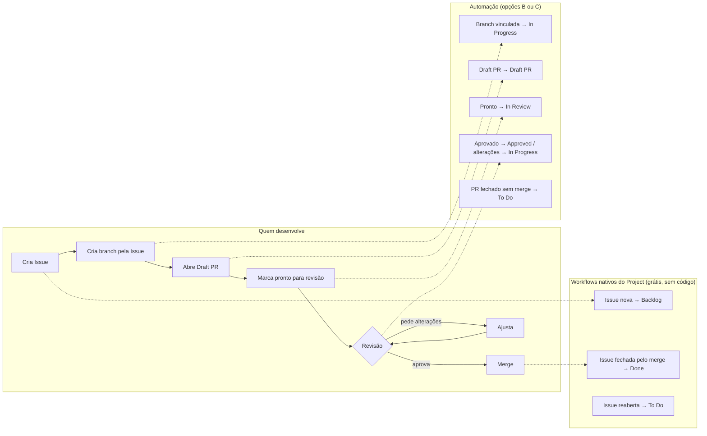

# Proposta — Kanban no GitHub Projects no lugar do roadmap em markdown

> Material de apresentação do laboratório. Detalhes técnicos e passo a passo: [`MANUAL-LAB.md`](MANUAL-LAB.md).

## 1. Problema

- O roadmap/planejamento vive em arquivos markdown no repositório e só muda via Pull Request.
- Ninguém sabe, olhando o arquivo, **o que está em andamento agora**: o status depende de alguém lembrar de editar.
- Tarefas, PRs e revisões não estão ligados entre si: para saber se algo foi revisado ou mergeado é preciso procurar.

## 2. Proposta

| Hoje | Proposta |
|---|---|
| Item de lista no markdown | **Issue** (com responsável, prioridade, tamanho, trimestre, área) |
| Status editado à mão via PR | **Kanban** no GitHub Projects, atualizado pelo próprio fluxo de trabalho |
| PR sem vínculo formal com a tarefa | PR vinculado à Issue (branch criada pela Issue ou `Closes #N`) |
| Sem visão consolidada | Views: **Kanban**, **Tabela**, **Roadmap** (linha do tempo) e **Sprint atual** |

**Colunas:** Sugestão → Backlog → To Do → In Progress → Draft PR → In Review → Approved → Done

**Migração:** o conteúdo atual é importado **uma vez** por script (`scripts/roadmap-migrate.py`), roda na máquina de quem migra e **não altera** nem precisa estar no repositório do produto.

## 3. Como os cards se movem



A automação **não confia no evento**: a cada execução ela lê o estado real do PR na API (rascunho? aprovado? alterações pedidas?) e calcula a coluna. Por isso o resultado é o mesmo se rodar 1 ou 10 vezes, e eventos perdidos são corrigidos na próxima execução.

## 4. Três opções de adoção

| | **A. Só o Project** | **B. Automação em repositório separado** | **C. Automação no repositório do produto** |
|---|---|---|---|
| Arquivos no repositório do produto | **Nenhum** | **Nenhum** | 3 workflows + 1 script (em `.github/`) |
| Issue nova → Backlog; merge → Done; reaberta → To Do | ✅ automático | ✅ automático | ✅ automático |
| PR vinculado → In Progress | ✅ (nativo *Pull request linked to issue*) | ✅ | ✅ |
| Branch criada → In Progress | ✋ manual | ✅ com atraso | ✅ em segundos |
| Draft PR / In Review / Approved | ✋ manual | ✅ com atraso | ✅ em segundos |
| PR fechado sem merge → To Do | ✋ manual | ✅ com atraso | ✅ em segundos |
| Atraso | — | Imprevisível: intervalo do agendamento + fila do GitHub (ver 4.1) | ~10–30 s |
| Minutos de Actions (repo privado) | 0 | Fixo, pelo agendamento (ver 4.2) | Proporcional ao número de PRs |
| O que o admin da org precisa fazer | Criar o Project | Project + GitHub App + repositório `kanban-automation` | Project + GitHub App + Secret no repositório do produto |

Na opção A, as colunas Draft PR / In Review / Approved podem ser movidas à mão, ou simplificadas (ex.: In Progress → In Review → Done).

### 4.1 Atraso medido na opção B (laboratório)

Teste com Issue descartável (#64, PR #65) e os workflows do repositório do produto **desligados** — em cada passo, o card só mudou depois que a opção B rodou:

| Ação | Resultado da reconciliação |
|---|---|
| Branch criada pela Issue | Backlog → **In Progress** ✅ |
| Draft PR aberto | → **Draft PR** ✅ |
| Pronto para revisão | → **In Review** ✅ |
| PR fechado sem merge | → **To Do** ✅ |

**Atraso:** com o cron a cada 5 minutos, o GitHub **não fez nenhuma execução agendada em mais de 45 minutos** logo após a criação do repositório (nem depois de um novo push). Os passos acima foram validados com *Run workflow* (cada execução leva ~20 s). Conclusão para a proposta: o agendamento do GitHub é "melhor esforço" — atrasos de vários minutos (ou mais, em repositório novo) são esperados. A opção B serve para manter o quadro **eventualmente** certo, não em tempo real.

### 4.2 Custo em minutos (repositório privado)

Cada execução curta é cobrada como **1 minuto** (Linux). O plano Free inclui 2.000 min/mês para repositórios privados da organização — e o repositório do produto já consome minutos com os builds (conferir em *Settings → Billing*).

| Opção | Configuração | Minutos/mês (aprox.) |
|---|---|---|
| B | A cada 5 min, 24×7 | ~8.600 ❌ inviável no Free |
| B | A cada 15 min, horário comercial (8h–18h, seg–sex) | ~970 |
| B | A cada 30 min, horário comercial | ~480 |
| C | ~8 execuções por PR × 40 PRs/mês + reconciliação de hora em hora no horário comercial | ~560 |

Repositório de automação **público** não consome minutos, mas os logs ficam públicos (mostram números de Issues/PRs e nomes de branches). Para a empresa, recomenda-se **privado**.

## 5. Recomendação

1. **Começar pela opção A + migração**: nenhum arquivo no repositório do produto, nenhum custo de Actions. O time valida o Kanban no dia a dia.
2. Se mover cards à mão incomodar, **evoluir para B** (sem tocar no código do produto), com agendamento a cada 15 min no horário comercial.
3. **C** só se o time aceitar os arquivos de automação no repositório e quiser atualização em segundos.

O mesmo `project-status.sh` serve para B e C: a evolução não exige reescrever nada.

## 6. Roteiro da demonstração (laboratório)

Ambiente: org `Gabs-X-Lab`, repositório `github-projects-lab`, Project "Lab Kanban" (opção C ativa) e repositório `kanban-automation` (opção B).

| # | Ação | Onde | O que mostrar |
|---|---|---|---|
| 1 | Abrir o Project nas views Kanban, Tabela e Roadmap | Project | Issues importadas do ROADMAP.md (#32–#61), sugestões como Draft Issues, sub-issues da #35 |
| 2 | Criar uma Issue | Repositório | Entra sozinha em **Backlog** (nativo) |
| 3 | *Create a branch* na barra Development da Issue | Issue | Card → **In Progress** |
| 4 | Commit + abrir **Draft PR** | Repositório | Card → **Draft PR**; PR aparece em *Development* sem precisar de `Closes` |
| 5 | *Ready for review* | PR | Card → **In Review** |
| 6 | Segunda conta pede alterações / aprova | PR | Card → **In Progress** / **Approved** |
| 7 | Squash and merge | PR | Issue fecha sozinha → **Done** (nativo) |
| 8 | Log da execução | *Actions* | Linha `PR #N: state=... reviewDecision=... → 'Approved'`: a coluna é calculada pelo estado real |
| 9 | Opção B | `kanban-automation` → *Actions* | Mesma lógica, agendada, sem arquivos no repositório do produto |

Comandos equivalentes (para demo pelo terminal):

```bash
gh issue create --title "Demo: exportar agenda em PDF" --body "Demo"
gh issue develop N --name feat/N-demo --checkout
git commit --allow-empty -m "demo" && git push
gh pr create --draft --title "Demo" --body "Demo"
gh pr ready
# segunda conta: gh pr review --approve
gh pr merge --squash --delete-branch
```

## 7. O que precisa de um owner/admin da organização

| Item | A | B | C |
|---|:-:|:-:|:-:|
| Criar o Project da organização (ou copiar o do lab com `copyProjectV2`) e configurar Auto-add | ✅ | ✅ | ✅ |
| Rodar a migração (`roadmap-migrate.py`) com acesso de escrita ao repositório | ✅ | ✅ | ✅ |
| Criar o GitHub App (Issues: read, Pull requests: read, Organization projects: read/write) e instalar **só** nos repositórios do produto | | ✅ | ✅ |
| Criar o repositório `kanban-automation` (privado), Secret e Variables | | ✅ | |
| Secret e Variables no repositório do produto + PR com os workflows | | | ✅ |
| Garantir permissão **Write** para quem revisa PRs | | ✅ | ✅ |

## 8. Pontos de atenção

- **Formato do planejamento atual:** o script de migração lê o formato do `ROADMAP.md` do lab. Para outros formatos (ex.: planos em vários arquivos ou em tabelas), basta outro "leitor" (`parse_*`); o restante do script não muda.
- **Repositório privado no plano Free não tem regra de revisão obrigatória:** a automação calcula "aprovado" pelas últimas revisões de quem tem Write (testado na Etapa 8).
- **Criar a branch pela Issue** é o hábito que faz tudo funcionar: vincula o PR sem `Closes #N` e marca o início do desenvolvimento.
- Mudanças de coluna não geram notificação nem aparecem na timeline da Issue.
